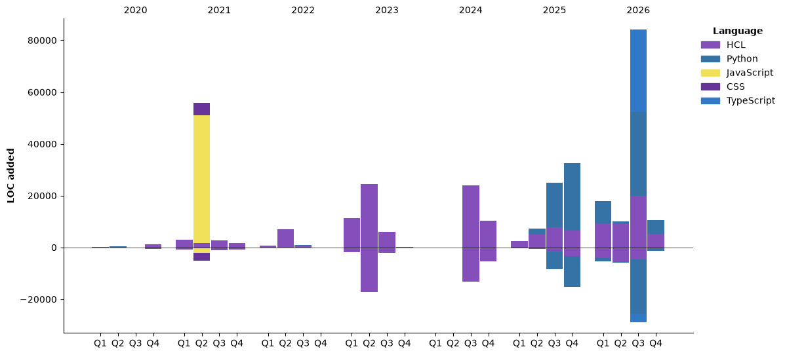

<h1 align="center">Hi, I'm Augusto 👋</h1>
<h3 align="center">Cloud & DevOps Engineer · AWS · Terraform · IoT · Python</h3>

<p align="center">
  <a href="https://www.linkedin.com/in/augustovaldivia/">Connect on LinkedIn</a> ·
  <a href="https://dev.to/valaug">Read my articles</a> ·
  <a href="https://github.com/ValAug?tab=repositories">Explore my repositories</a>
</p>

I focus on cloud infrastructure, infrastructure as code, and automation, with an interest in connecting IoT systems to the cloud. I share practical lessons on AWS, Terraform, and cloud security in English and Spanish.

## 🚀 Featured Projects

> **Draft placeholders:** Select three real repositories and replace the entries below before publishing. These describe suggested showcase topics, not verified projects.

| Project to select | What to highlight | Relevant stack |
| :--- | :--- | :--- |
| **AWS infrastructure with Terraform** | Infrastructure design, reusable modules, and deployment instructions. | AWS · Terraform · HCL |
| **IoT and cloud integration** | Device connectivity, data flow, and an architecture diagram. | AWS · IoT · Python |
| **Cloud automation** | A manual task automated with code, examples, and operational benefits. | Python · GitHub · AWS |

[Browse all repositories →](https://github.com/ValAug?tab=repositories)

## 🧰 Technical Stack

| Area | Technologies |
| :--- | :--- |
| **Cloud & infrastructure** | AWS · Terraform · AWS CloudFormation |
| **Programming** | Python · JavaScript · HTML · CSS |
| **Databases** | PostgreSQL · MongoDB · MySQL |
| **Web & mobile** | React · React Native |
| **Code collaboration** | GitHub |

## ✍️ Latest Articles

Practical notes on cloud security, infrastructure automation, and the AWS community, in English and Spanish.

<!-- BLOG-POST-LIST:START -->
- [El error de seguridad más común es “Dale Admin y Ya” Cómo solucionarlo con Terraform](https://dev.to/aws-espanol/el-error-de-seguridad-mas-comun-es-dale-admin-y-ya-o82)
- [IAM Least Privilege: What Everyone Gets Wrong &lpar;and How to Fix It with Terraform&rpar;](https://dev.to/aws-builders/iam-least-privilege-what-everyone-gets-wrong-and-how-to-fix-it-with-terraform-2k5j)
- [AWS Summit Toronto 2025: De la Supervisión Humana a la IA Agéntica](https://dev.to/aws-espanol/aws-summit-toronto-2025-reflexiones-de-dos-dias-inspiradores-3m9n)
- [AWS Summit Toronto 2025: From Human Oversight to Agentic AI](https://dev.to/aws-builders/aws-summit-toronto-2025-reflections-from-two-inspiring-days-1imb)
- [Cómo Aprobar el Examen de AWS Solutions Architect Professional Como un Verdadero Pro](https://dev.to/aws-espanol/como-aprobar-el-examen-de-aws-solutions-architect-professional-como-un-verdadero-pro-lf5)
<!-- BLOG-POST-LIST:END -->

[More articles on DEV.to →](https://dev.to/valaug)

## 📊 GitHub Activity

[Explore my contribution history and repositories →](https://github.com/ValAug)

<!-- Add generated cards here after the card workflow is configured:
<p>
  
  
</p>
-->

<details>
<summary>More development activity</summary>

<!--START_SECTION:waka-->


**🐱 My GitHub Data** 

> 📦 72.9 kB Used in GitHub's Storage 
 > 
> 🏆 481 Contributions in the Year 2026
 > 
> 🚫 Not Opted to Hire
 > 
> 📜 32 Public Repositories 
 > 
> 🔑 11 Private Repositories 
 > 
**I'm an Early 🐤** 

```text
🌞 Morning                2344 commits        █████████░░░░░░░░░░░░░░░░   37.40 % 
🌆 Daytime                3273 commits        █████████████░░░░░░░░░░░░   52.23 % 
🌃 Evening                630 commits         ███░░░░░░░░░░░░░░░░░░░░░░   10.05 % 
🌙 Night                  20 commits          ░░░░░░░░░░░░░░░░░░░░░░░░░   00.32 % 
```
📅 **I'm Most Productive on Tuesday** 

```text
Monday                   1083 commits        ████░░░░░░░░░░░░░░░░░░░░░   17.28 % 
Tuesday                  1247 commits        █████░░░░░░░░░░░░░░░░░░░░   19.90 % 
Wednesday                1091 commits        ████░░░░░░░░░░░░░░░░░░░░░   17.41 % 
Thursday                 1144 commits        █████░░░░░░░░░░░░░░░░░░░░   18.25 % 
Friday                   1099 commits        ████░░░░░░░░░░░░░░░░░░░░░   17.54 % 
Saturday                 430 commits         ██░░░░░░░░░░░░░░░░░░░░░░░   06.86 % 
Sunday                   173 commits         █░░░░░░░░░░░░░░░░░░░░░░░░   02.76 % 
```


📊 **This Week I Spent My Time On** 

```text
🕑︎ Time Zone: America/Toronto

💬 Programming Languages: 
No Activity Tracked This Week

🔥 Editors: 
No Activity Tracked This Week
```

🤖 **AI Coding This Week** 

```text
No AI Coding Activity Tracked This Week
```

**I Mostly Code in HCL** 

```text
HCL                      65 repos            ███████████████████░░░░░░   76.47 % 
Python                   14 repos            ████░░░░░░░░░░░░░░░░░░░░░   16.47 % 
TypeScript               2 repos             █░░░░░░░░░░░░░░░░░░░░░░░░   02.35 % 
JavaScript               2 repos             █░░░░░░░░░░░░░░░░░░░░░░░░   02.35 % 
CSS                      1 repo              ░░░░░░░░░░░░░░░░░░░░░░░░░   01.18 % 
```


**Timeline**




 Last Updated on 12/11/2026 06:58:22 UTC
<!--END_SECTION:waka-->

</details>

## 🤝 Let's Connect

Interested in AWS, Terraform, cloud security, or IoT? [Connect with me on LinkedIn](https://www.linkedin.com/in/augustovaldivia/) or explore my [technical writing](https://dev.to/valaug).
